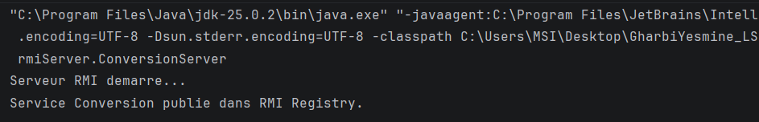
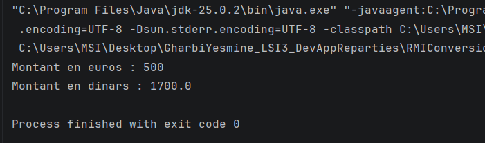

# TP : Application répartie avec Java RMI – Conversion de devises

**Réalisé par :** Gharbi Yesmine  
**Niveau :** LSI3  
**Module :** Développement d'applications réparties

---

## 1. Présentation du TP

L'objectif de ce TP est de concevoir une application répartie en Java utilisant la technologie **Java RMI (Remote Method Invocation)**.

Cette application permet à un client de demander à un serveur distant de convertir un montant en euros vers le dinar tunisien.

Le projet est composé de deux applications Java indépendantes :

- **RMIConversion_Server :** représente le serveur qui fournit le service de conversion.
- **RMIConversion_Client :** représente le client qui utilise le service distant.


## 2. Architecture du projet

Le projet est organisé comme suit :

```text
GharbiYesmine_LSI3_DevAppReparties/
│
├── README.md
│
├── capture/
│   ├── server.png
│   └── client.png
│
├── conversionClient.jar
│
├── RMIConversion_Server/
│   └── src/
│       ├── rmiService/
│       │   ├── IConversion.java
│       │   └── ConversionImpl.java
│       │
│       └── rmiServer/
│           └── ConversionServer.java
│
└── RMIConversion_Client/
    └── src/
        └── rmiClient/
            └── ConversionClient.java
```


## 3. Exécution de l'application

### 3.1. Exécution du serveur

Nous commençons par lancer l'application `ConversionServer`.

Le serveur démarre correctement et publie le service de conversion dans le RMI Registry.

**Capture d'écran de l'exécution du serveur :**



### 3.2. Exécution du client

Après le démarrage du serveur, nous exécutons l'application `ConversionClient`.

Le client se connecte au serveur et demande la conversion de 500 euros.

**Capture d'écran de l'exécution du client :**




## 4. Conclusion

Ce TP nous a permis de découvrir et de mettre en pratique la technologie Java RMI pour développer une application répartie.

Nous avons appris à créer une interface distante, à implémenter un service, à démarrer le RMI Registry, à publier un objet distant et à invoquer une méthode depuis une application cliente.

Ce travail nous a permis de mieux comprendre les mécanismes de communication entre applications Java réparties et l'utilisation des objets distants.